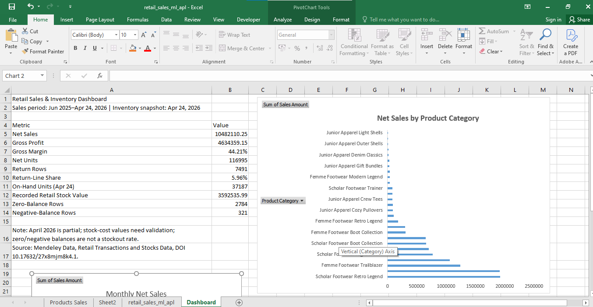
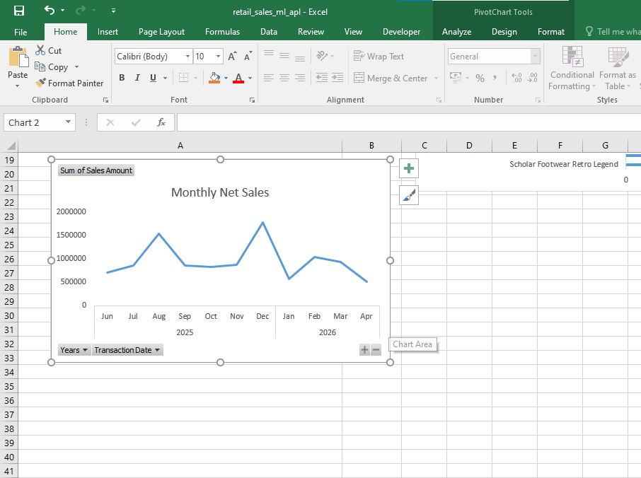

# Retail Sales & Inventory Performance Analysis

An Excel portfolio analysis of a retail sales and inventory sample. The workbook summarizes sales by category and month, calculates sales KPIs, and uses stock validity dates to create an April 24, 2026 inventory snapshot.

## Dashboard preview

## Key findings

| Measure | Result |
|---|---:|
| Net sales | $10,482,110.25 |
| Net units | 116,995 |
| Gross profit | $4,634,359.15 |
| Gross margin | 44.21% |
| Return rows | 7,491 (5.96% of rows; not a customer return rate) |
| Return value magnitude | $733,571.01 |
| Inventory on hand, April 24, 2026 | 37,187 units |
| Recorded retail inventory value, April 24, 2026 | $3,592,535.99 |
| Active zero / negative balance rows | 2,784 / 321 |

The highest sales months were December 2025 ($1.79M) and August 2025 ($1.54M). April 2026 is partial through April 24. Top categories were Scholar Footwear Retro Legend and Scholar Footwear Trailblazer, each near $1.9M.

## Tools and work performed

- **Microsoft Excel**: SUM, COUNTIF, SUMIF, SUMIFS, PivotTables, and PivotCharts for KPIs, category mix, monthly trend, and the date-aware stock snapshot.
- **SQL scripts**: optional MySQL templates are included under `sql/`; they have not been run as part of this Excel analysis.
- **Power BI DAX notes**: included as a possible next step; a Power BI report has not been built.

## Data and limitations

The source describes a retail sample of 40 storefronts and 2,326 SKUs. The retailer and full collection method are not identified. Returns are represented by negative quantities and amounts. Inventory cost amounts do not consistently reconcile to quantity multiplied by unit cost, so recorded stock cost should not be treated as validated. Zero and negative stock rows are counts, not a verified stockout rate. A separate full-file audit matched an active inventory interval for about 73.6% of sales rows; unmatched sales must be retained and reported.

Raw CSVs and Excel workbooks are not included. Obtain the CSV files from the [Mendeley Data record](https://data.mendeley.com/datasets/27x8mjm8k4/1), DOI `10.17632/27x8mjm8k4.1`. The dataset is shared under CC BY 4.0; cite the source when reusing the data.

## Repository contents

- `assets/`: Excel dashboard screenshots.
- `data/README.md`: source, attribution, and instructions for placing local data.
- `docs/`: walkthrough, data dictionary, audit findings, and KPI definitions.
- `powerbi/dax_measures.md`: DAX examples for a future Power BI version.
- `sql/`: MySQL schema/load, validation, and analysis templates.
- `analysis_summary.csv`: headline measures shown in the dashboard.

## Reproduce the Excel analysis

1. Obtain the two CSV files from the source record and keep the originals unchanged.
2. Follow the formulas and PivotTable steps in `docs/project_walkthrough.md`.
3. For the inventory snapshot, include rows where `Start Date <= 2026-04-24` and `End Date >= 2026-04-24`.
4. Compare outputs with `analysis_summary.csv` and review caveats in `docs/data_quality.md`.

The findings are descriptive for the supplied sample and do not establish causality or forecast future performance.
