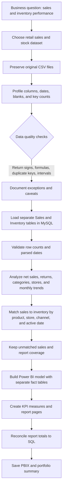

# Project flowchart

## What each arrow means

1. Agree the question and narrow scope to what these files support.
2. Record the source and attribution details.
3. Read the originals without editing them.
4. Learn the actual field names, row counts, and date ranges.
5. Check the values and relationships before calculating results.
6. Make limitations visible rather than hiding or “fixing” them without evidence.
7. Load two separate tables; do not flatten intervals into daily stock rows.
8. Confirm the database matches the input files.
9. Calculate business measures at their valid grain.
10. Use an as-of interval match, not just a product lookup.
11. Preserve sales rows even where no stock interval is available.
12. Model dimensions filtering each fact table independently.
13. Build clear reusable measures and visuals.
14. Compare dashboard cards with known query totals.
15. Save the reviewable final dashboard and short explanation.

The data audit and this flowchart are complete. Database execution and the final Power BI file remain to be done in MySQL Workbench and Power BI Desktop.
